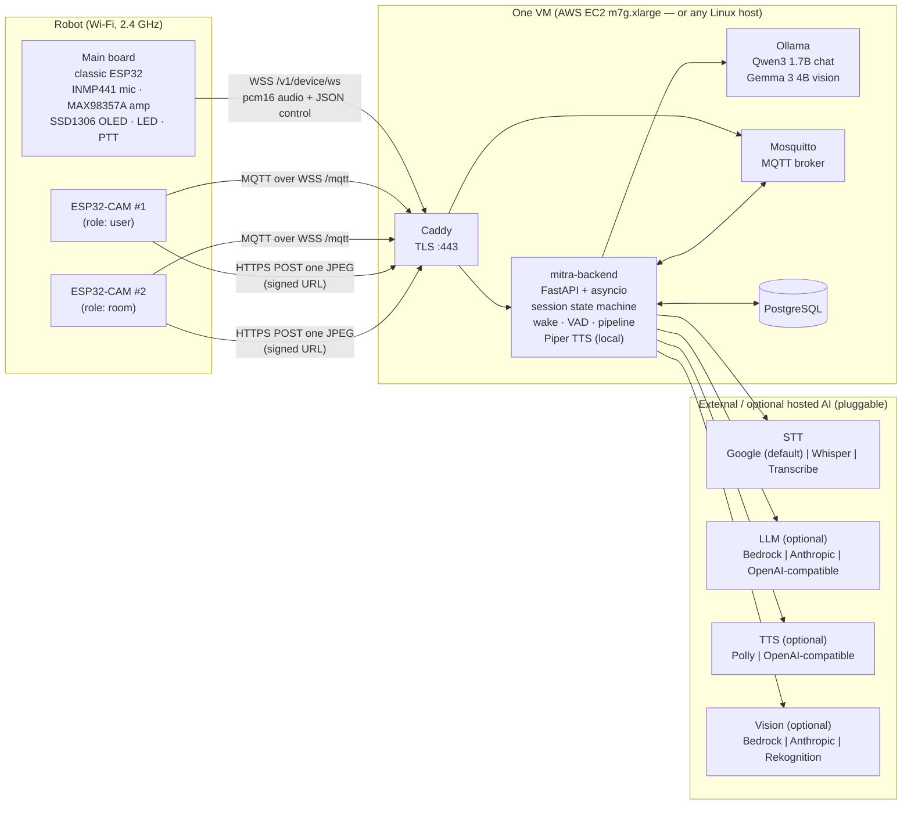

# Mitra — architecture (v0.1)

Implements *Mitra Robot — Software PRD (ESP32 + AWS) v0.1*, with two standing constraints from
Smith & Sky: **stay as cloud-provider-agnostic as possible**, and **keep AWS cost low** (EC2-hosted
DB, compute and APIs).

## One conversation turn

1. **Idle.** In cloud-wake mode the board's VAD streams only speech (plus ~0.8 s pre-roll). The
   backend runs the wake engine on it **in RAM only** and drops it (FR-2.2/2.4). In PTT mode nothing
   leaves the board until the button is pressed.
2. **Wake** → backend sends `wake`; board chimes, mic is gated during the chime; state `listening`.
3. **Listening.** Audio streams into STT as it arrives; server-side VAD finds end of speech
   (800 ms silence), or PTT release, or 15 s cap. No speech for 6 s → `standby` cue (FR-1.3).
4. **Processing.** Low-confidence / empty transcript → `repeat` cue, max 2 times (FR-1.4).
   Vision intent ("what do you see") → capture from the paired camera, describe, inject as
   `[Camera observation]`.
5. **Responding.** LLM tokens are split into sentences; sentence 1 goes to TTS as soon as it
   exists; audio streams to the board, paced to its jitter buffer. Mic gated (FR-3.2).
6. Board reports `playback_done` (+ measured first-audio-to-speaker) → optional 4 s follow-up
   window without the wake word → idle.
7. Any stage timeout (STT 8 s, LLM 10 s first token, TTS 8 s) → `error` + local `no_brain` clip
   from flash (FR-4.4). Lost Wi-Fi mid-turn → local `no_wifi` clip (scenario 4).

Per-stage timings are stored per turn (no transcript text) and exposed as a report (FR-3.4) and as
Prometheus histograms.

## Where the code is

| Path | What |
|---|---|
| `backend/mitra/session/conversation.py` | Per-device state machine: wake, endpointing, timeouts, fallbacks, pacing, metrics |
| `backend/mitra/providers/` | Pluggable STT / LLM / TTS / wake / vision / storage (+ mocks) |
| `backend/mitra/camera.py` | Capture orchestration over MQTT + signed upload URLs |
| `backend/mitra/bus/mqtt.py` | MQTT client + Mosquitto password-file sync |
| `backend/mitra/main.py` | WebSocket, upload, OTA and admin endpoints |
| `backend/config/mitra.yaml`, `system_prompt.md` | Persona, providers, timeouts (FR-4.6), safety prompt (FR-4.5) |
| `firmware/main-board/` | ESP-IDF 5.3 app for the classic ESP32 |
| `firmware/camera-node/` | ESP-IDF 5.3 app for ESP32-CAM (AI-Thinker) |
| `firmware/components/mitra_common/` | Credentials, Wi-Fi provisioning, verified OTA (shared) |
| `deploy/` | docker-compose stack, Caddy, Mosquitto, Terraform (AWS), bootstrap scripts |

## Deviations from the PRD (and why)

| PRD §4.2 proposal | Implemented | Reason |
|---|---|---|
| ECS Fargate + ALB for the audio WebSocket | One EC2 VM running docker-compose, Caddy for TLS | ALB alone costs more per month than the whole VM; Fargate adds per-task cost. Compose runs on any cloud or on-prem box. |
| AWS IoT Core (X.509, Device Shadow, MQTT) | Mosquitto + per-device secret; shadow stored in Postgres (`devices.reported` / `config`) | Free, portable, standard MQTT; firmware can be pointed at IoT Core/EMQX later without code changes. Secrets are hashed server-side and flashed to a separate NVS partition, never in firmware or repo. |
| Main board: MQTT for control + WSS for audio | Main board uses **one** WSS connection for both | A classic ESP32 without PSRAM can't comfortably hold two TLS sessions next to audio buffers. Cameras (with PSRAM) use MQTT as the PRD describes. |
| DynamoDB with TTL | PostgreSQL with `expires_at` + hourly purge | Portable SQL; runs on the same VM at no extra cost. |
| Pre-signed S3 PUT + Lambda for frames | Signed one-shot upload URL to the API; frame analysed in memory, never stored | No S3/Lambda cost, nothing to clean up, FR-5.5 by construction. Optional debug retention writes to local disk or any S3-compatible bucket. |
| CloudWatch logs/metrics/alarms | JSON logs to stdout (rotated, 30 MB cap) + Prometheus `/metrics`; AWS Budgets alarm | Vendor-neutral; ship logs to CloudWatch with the Docker `awslogs` driver if wanted. |
| Secrets Manager | `.env` generated on the box (600) + optional `ssm:/path` references in YAML; admin token mirrored to SSM Parameter Store | Parameter Store standard tier is free; nothing secret enters Terraform state. |
| Opus uplink compression (FR-2.3 "consider") | Raw pcm16 in v1 | Uplink to AWS is free; Wi-Fi bandwidth (32 KB/s) is fine on a LAN; saves ESP32 CPU. `opus` extra reserved for later. |
| Barge-in | Button barge-in only (PTT press stops playback) | Single mono mic, no AEC — matches PRD §11 item 4. |

## Portability checklist

* No AWS SDK call outside `providers/` (and the optional `ssm:` config resolver).
* Every external capability has at least one non-AWS implementation and a mock.
* Deploy = "any VM with Docker": `deploy/scripts/bootstrap.sh`. Terraform is only the AWS wrapper.
* Storage is S3-API (works with R2, MinIO, GCS interop) or local disk.
* MQTT is plain MQTT 3.1.1/5; the device protocol is documented in `PROTOCOL.md`.
